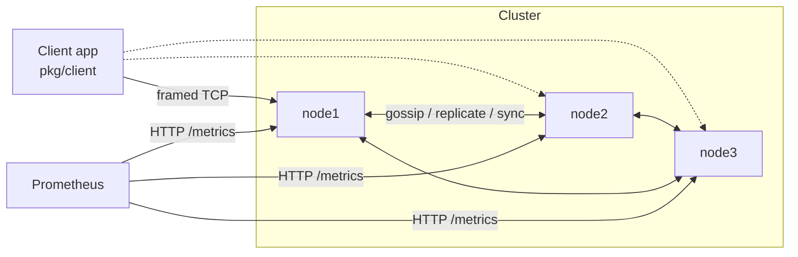

# Self-Healing Distributed Cache

A replicated, partitioned, in-memory key-value cache written from first principles in Go
(standard library only). Nodes find each other through gossip, detect failures with
heartbeats, keep serving through node crashes, resynchronize nodes that come back
with stale or empty memory, and rebalance data when members join, leave or are
removed.

The project is built for learning and for showing engineering judgment. It is **not**
production software, and it is upfront about what it does not guarantee. See
[Known limitations](#known-limitations) and [docs/CONSISTENCY_MODEL.md](docs/CONSISTENCY_MODEL.md).



## What it does

| Capability | How |
|---|---|
| Partitioning | Consistent hashing with 128 virtual nodes per member ([ring](internal/ring)) |
| Replication | RF copies (default 3); the first routable owner coordinates and versions each write |
| Write acknowledgement | Success after **W** owners apply it (default majority: 2 of 3) |
| Reads | `one` (the coordinator's copy) or `quorum` (newest of R=2, with read repair) |
| Ordering | Hybrid logical clock versions, last-writer-wins, idempotent replication |
| Failure detection | All-to-all heartbeats: alive → suspect (1.5 s) → dead (4 s) |
| Self-healing | Nodes return through a *joining* phase and resync before they are routed to; the majority removes long-dead members (30 s) and restores RF |
| Partition safety | Strict owner quorums. A node that sees ≤ half the ring refuses requests. Only the majority reassigns ownership |
| Rebalancing | One digest/push sync engine for join, leave, removal, anti-entropy and handoff, throttled in keys/s |
| Memory | Bounded bytes/entries, LRU or LFU eviction, TTL (lazy + sampled sweep), tombstones |
| Operations | Structured JSON logs with request IDs, Prometheus metrics, health/readiness, admin API, fault injection |

## Quick start

**Docker Compose (three nodes):**

```bash
docker compose up -d --build          # data ports 7001-7003, admin 8001-8003
curl -X PUT localhost:8001/v1/kv/user:42 -d alice
curl localhost:8003/v1/kv/user:42     # any node answers; it forwards to an owner
curl localhost:8001/cluster           # membership, liveness, ownership
./scripts/demo.sh                     # scripted crash -> detect -> recover -> partition demo
```

If Docker Hub rate-limits you, build from a mirror:
`GO_IMAGE=mirror.gcr.io/library/golang:1.22-alpine docker compose build`.

**In the browser (free):** open the repo in GitHub Codespaces (Code → Codespaces →
Create). The dev container includes Go and Docker. Then run
`docker compose up -d --build && ./scripts/demo.sh`.

**Without Docker:**

```bash
make cluster                          # 3 local processes (logs in .run/)
bin/cachectl set greeting hello -ttl 1m
bin/cachectl get greeting
bin/cachectl owners greeting
./scripts/local-cluster.sh kill 2     # SIGKILL node2
bin/cachectl get greeting             # still served by the surviving replicas
./scripts/local-cluster.sh restart 2  # node2 resyncs before it is ready
make stop
```

**As a library:**

```go
c, _ := client.New(ctx, client.Config{Seeds: []string{"127.0.0.1:7001"}})
v, err := c.Set(ctx, "user:42", []byte("alice"), time.Minute) // returns the write's version
r, err := c.GetQuorum(ctx, "user:42")                          // newest of a majority
```

## Demonstration (actual output in [docs/DEMO.md](docs/DEMO.md))

1. Start three nodes. 2. Write and read a key. 3. Verify replication. 4. SIGKILL a node.
5. Watch alive → suspect → dead. 6. Read from survivors and keep writing. 7. Restart the node.
8. Watch it resync before becoming ready. 9. Quorum-read the write it missed.
10. Partition a node: it refuses requests, the majority keeps writing, and on heal it resyncs.

## Measured results

Measured on a shared 4-vCPU VM, with all three nodes **and** the load generator on the same
machine and 128 B values. Full methodology and caveats are in [docs/BENCHMARKS.md](docs/BENCHMARKS.md).

| Workload (c = concurrent clients) | RF=3, W=2 | RF=1 |
|---|---|---|
| GET c=32 | 57.6k ops/s, p99 2.9 ms | 59.6k ops/s, p99 2.2 ms |
| SET c=1 | 3.7k ops/s, p50 264 µs | 7.8k ops/s, p50 124 µs |
| SET c=32 | 22.6k ops/s, p99 6.2 ms | 56.9k ops/s, p99 2.9 ms |
| Failure detection (SIGKILL → dead) | 4.2 s (timeout 4 s) | |
| Restart with empty memory → ready (50k keys) | 2.6 s | |
| Kill + restart a node during 90/10 load | **0 client errors** (748k ops) | |
| 100k keys, cluster memory for ~17.5k, zipf access | hit ratio 0.75 | |

## Repository layout

```
cmd/cachenode     node binary           internal/store       storage engine (TTL, LRU/LFU, versions)
cmd/cachectl      CLI client            internal/ring        consistent hashing
cmd/cachebench    load generator        internal/membership  phases, liveness, dead marks
pkg/client        Go client library     internal/protocol    wire format
test/e2e          multi-process test    internal/transport   multiplexed TCP, fault injection
scripts/          demo, bench, cluster  internal/node        coordinator, gossip, sync, admin
docs/             design docs + ADRs    internal/metrics     Prometheus exposition
```

## Documentation

| Document | Contents |
|---|---|
| [ARCHITECTURE](docs/ARCHITECTURE.md) | Components, diagrams, request and failure sequences |
| [REQUIREMENTS](docs/REQUIREMENTS.md) | Goals, non-goals, requirements, acceptance criteria and status |
| [CONSISTENCY_MODEL](docs/CONSISTENCY_MODEL.md) | Exactly what is and is not guaranteed |
| [FAILURE_MODES](docs/FAILURE_MODES.md) | Crash, restart, stale return, partition, total loss |
| [REBALANCING](docs/REBALANCING.md) | Ownership transitions and the sync protocol |
| [PROTOCOL](docs/PROTOCOL.md) | Framing, messages, error codes, HTTP API |
| [TESTING](docs/TESTING.md) | Test inventory, what passed, what is untested |
| [BENCHMARKS](docs/BENCHMARKS.md) | Methodology, results, profile, bottlenecks |
| [OPERATIONS](docs/OPERATIONS.md) | Configuration and troubleshooting runbooks |
| [DEPLOYMENT](docs/DEPLOYMENT.md) | Cloud deployment guide, including free hosting options |
| [LEARNING_GUIDE](docs/LEARNING_GUIDE.md) | Concept roadmap, exercises, interview explanations |
| [ROADMAP](docs/ROADMAP.md) | MVP → advanced → stretch, and what is next |
| [ADR](docs/ADR) | Architecture decision records |

## Testing

```bash
make race    # unit + in-process cluster + fault-injection tests with the race detector
make e2e     # three real processes, SIGKILL, restart, resync
make fuzz    # fuzz the frame decoder
./scripts/bench.sh && ./scripts/failover-timing.sh && ./scripts/bench-failure.sh
```

## Known limitations

- **No consensus.** Membership is gossip-based. Split-brain is reduced (strict owner quorums, minority refusal, majority-only removal) but not eliminated. See [FAILURE_MODES](docs/FAILURE_MODES.md#network-partition).
- **Not linearizable.** Writes are last-writer-wins by hybrid-logical-clock version, so concurrent writes from different coordinators are ordered by clocks, not real time.
- **Partitions:** removal needs a majority of the ring to report a member dead, so
  non-transitive partitions don't cause removals. All fault tests ran on one host;
  real multi-machine networks are untested.
- **Stale-read windows exist.** One window is between a partition starting and the isolated node noticing (up to `SHC_DEAD_AFTER`). Another is while ownership changes are still propagating by gossip.
- **In-memory only.** If every replica of a key is lost, the key is gone, and reads report a miss.
- **All-to-all heartbeats** cost O(n²) messages; aimed at clusters of a few to ~20 nodes.
- **No authentication or TLS** on either port. Run only on a private network.

## License

MIT
