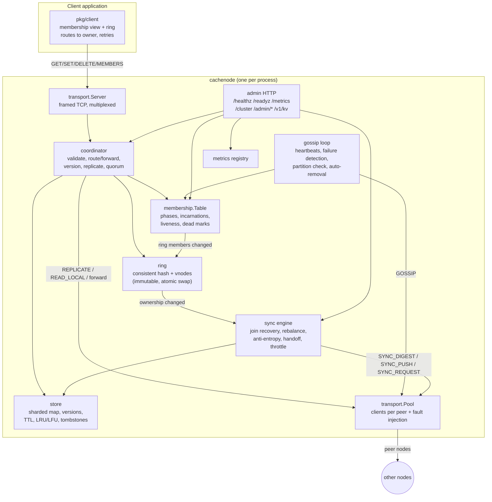
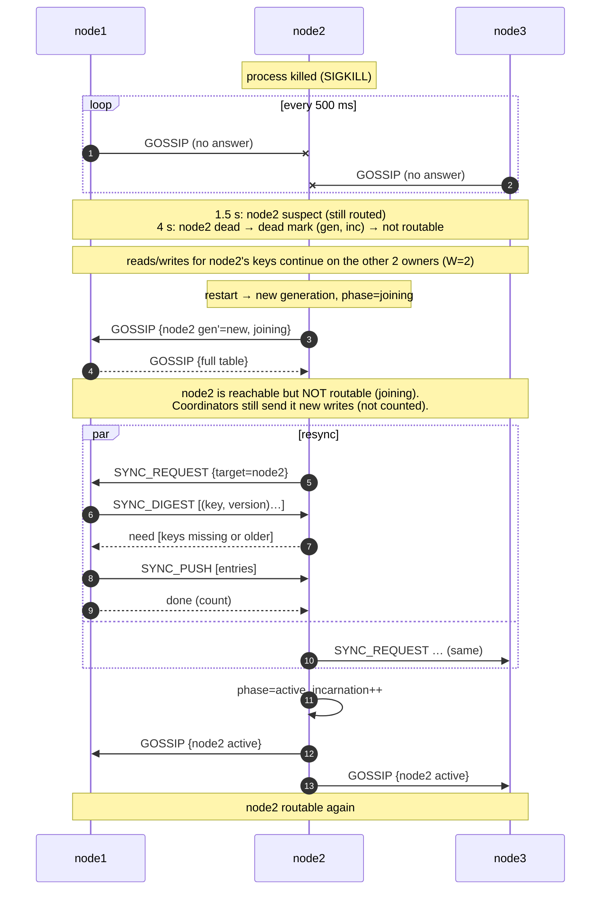

# Architecture

## 1. The problem in plain terms

A **cache** keeps recently used data in memory so applications avoid a slow source
(a database or another service). One cache server is simple, but it has a memory and
CPU ceiling, and when it dies every client loses the cache at once. That second
problem is a *single point of failure*.

A **distributed cache** spreads keys across several servers (**sharding**), so capacity
grows with the number of nodes. Each key also lives on more than one server
(**replication**), so losing a server doesn't lose its keys.

Picture an app server talking to three cache nodes, `node1`–`node3`, with replication
factor 3:

- `SET user:42 alice` reaches `node1`, the first owner of `user:42`. node1 stores the
  value, sends it to `node2` and `node3`, and answers "OK" once one replica has also
  confirmed (2 of 3 copies).
- `node2` is killed. From the outside, a crashed node, a node frozen by a long GC pause
  and a node behind a broken switch all look the same: **it stops answering**. Peers
  only see missing heartbeats. After 1.5 s they *suspect* it; after 4 s they declare it
  *dead* and stop routing to it. Reads and writes for `user:42` continue on node1 and
  node3, still with 2 copies.
- `node2` restarts with **empty** memory. It must not answer reads yet, because it
  knows nothing. It enters a **joining** phase, asks its peers for everything it owns,
  and only then announces itself **active**.
- If node2 had been **partitioned** instead of crashed, it would come back with **stale**
  data: it missed the writes the majority accepted meanwhile. The cluster treats this
  like a restart. Peers that declared it dead refuse to route to it until it has
  resynchronized and bumped its incarnation number.

**Self-healing** here means the cluster puts itself back into a correct, fully
replicated state without an operator:

- It stops routing to failed nodes.
- It resyncs returning ones.
- It reassigns the ranges of members that stay dead.
- It repairs replicas that missed writes.

Self-healing does **not** mean "no data is ever lost". If every copy of a key is lost,
the key is gone; this is a cache, not a database. It also does not mean failure
detection is perfect: a timeout cannot distinguish "dead" from "slow" or "unreachable
from here".

### How this differs from "just use Redis"

Redis Cluster already does sharding, replication and failover. This project builds
those mechanisms from scratch to make the trade-offs visible: wire framing, consistent
hashing, versioned replication, quorum acknowledgement, heartbeat failure detection,
membership gossip, resynchronization and throttled rebalancing. It also makes different
choices. Redis Cluster uses asynchronous primary→replica replication and
majority-of-primaries failover. This project uses per-key preference lists with
synchronous W-of-RF acknowledgement and LWW versions (closer to Dynamo/Cassandra).

## 2. Logical architecture



### Component responsibilities

| Component | Responsibility | Code |
|---|---|---|
| Client library | Fetch membership (`MEMBERS`), build the same ring, send each request to the first routable owner, refresh and retry on errors | `pkg/client` |
| Transport | Length-prefixed frames, request IDs, one multiplexed connection per peer, bounded frame size, per-connection concurrency limit, fault injection | `internal/transport`, `internal/protocol` |
| Coordinator | Validate input; compute owners; forward to the coordinator; assign the version; apply locally; replicate; wait for W acks; quorum reads with read repair | `internal/node/coordinator.go` |
| Store | Per-key `Entry{value, version, expireAt, tombstone}`; apply only newer versions; lazy and sampled TTL expiry; memory/entry bounds; LRU or LFU | `internal/store` |
| Ring | Consistent hashing with virtual nodes; `Owners(key, RF)` preference list | `internal/ring` |
| Membership | Member records (`gen`, `inc`, `phase`) merged by gossip; local liveness; dead marks; routability rules | `internal/membership` |
| Gossip / failure detection | Heartbeat every peer every 500 ms with the full table; suspect/dead timeouts; minority detection; majority-only auto-removal | `internal/node/gossip.go` |
| Sync engine | Digest/push synchronization used for join, recovery, rebalancing, anti-entropy, graceful leave and cleanup; token-bucket throttle | `internal/node/sync.go` |
| Admin / observability | Health, readiness, Prometheus metrics, cluster view, recovery status, fault injection, HTTP KV gateway, optional pprof | `internal/node/admin.go`, `internal/metrics` |

### Logical ownership vs. physical placement

- **Logical ownership** is a pure function: `ring(members).Owners(key, RF)`. Every node and
  client with the same membership computes the same answer.
- **Physical placement** is where bytes actually are right now. Right after a membership
  change they differ: the new owner has not received the data yet, and the old owner
  still holds a copy. The sync engine closes the gap. The *joining* phase and dual writes
  make sure clients are never routed to an owner that has not caught up. See
  [REBALANCING.md](REBALANCING.md).

## 3. What actually runs (initial implementation)

The logical components above all live in **one OS process per node** (`cachenode`).
There is no separate router, coordinator service or membership service.

| Process | Count | Ports |
|---|---|---|
| `cachenode` | 3 in Compose (any N ≥ 1) | `7000` framed TCP (clients + peers), `8000` HTTP admin |
| application with `pkg/client`, or `cachectl` / `cachebench` | any | client side only |
| Prometheus (optional Compose profile) | 0–1 | `9090` |

Inside a node, goroutines run: the TCP accept loop, one reader per connection plus one
goroutine per in-flight request, the heartbeat loop, the rebalance loop, the recovery
loop, the store's expiration sweeper and the HTTP server.

## 4. Key flows

### Normal write (RF=3, W=2)

```mermaid
sequenceDiagram
  autonumber
  participant C as Client
  participant N3 as node3 (not owner #1)
  participant N1 as node1 (first routable owner)
  participant N2 as node2 (replica)
  C->>N3: SET user:42 alice  (client view was stale)
  N3->>N3: owners(user:42) = [node1, node3, node2]; first routable = node1
  N3->>N1: SET user:42 (forwarded=true)
  N1->>N1: version = HLC.next() @node1, apply locally (ack 1)
  par replicate
    N1->>N2: REPLICATE {entry, version}
    N1->>N3: REPLICATE {entry, version}
  end
  N2-->>N1: ok (ack 2 = W)
  N1-->>N3: ok, version, acks=2
  N3-->>C: ok
  N3-->>N1: (late) ok — replication continues in background
```

A write is acknowledged **only after** W owners that are routable in the coordinator's
view have applied it. The coordinator counts itself as one. If fewer than W owners are
routable, the write is refused **before** anything is applied (`unavailable`). If
replicas fail during the write, the client gets `quorum_failed`: the value *may* be
visible on some replicas, and anti-entropy will eventually spread it.

### Node failure followed by recovery



If node2 never comes back, the majority removes it after `SHC_REMOVE_DEAD_AFTER` (30 s).
Its ranges get new owners, and rebalancing copies data to them, restoring RF.

## 5. Concurrency model

| State | Protection |
|---|---|
| Store | 16 shards, each with its own `sync.Mutex`. `Get` takes the exclusive lock because it updates LRU/LFU metadata. Hits and misses are atomic counters |
| Ring | Immutable value published through `atomic.Pointer`; readers never lock |
| Membership table | `sync.RWMutex`; every method copies data out |
| Transport connection | Writes serialized by a mutex; one reader goroutine dispatches responses by ID to buffered channels |
| HLC clock | `sync.Mutex` |
| Background loops | Owned by the node's root `context.Context`. `Kill`/`Stop` cancel it, close listeners and wait on a `WaitGroup` |
| Rebalance passes | Serialized by a per-node mutex. Join-sync handlers are limited to 2 concurrent by a semaphore |

The race detector runs on every test in CI.

## 6. Design decisions

The major decisions and their alternatives are recorded in [ADR/](ADR):
Go ([0001](ADR/0001-language-go.md)), framed TCP + JSON ([0002](ADR/0002-protocol.md)),
consistent hashing with vnodes ([0003](ADR/0003-placement.md)), coordinated replication
with W-of-RF quorums ([0004](ADR/0004-replication.md)), heartbeats with dead marks
([0005](ADR/0005-failure-detection.md)), the consistency model ([0006](ADR/0006-consistency.md)),
a single sync engine for every data-movement case ([0007](ADR/0007-sync-engine.md)), and
no consensus protocol in this version ([0008](ADR/0008-no-consensus.md)).
