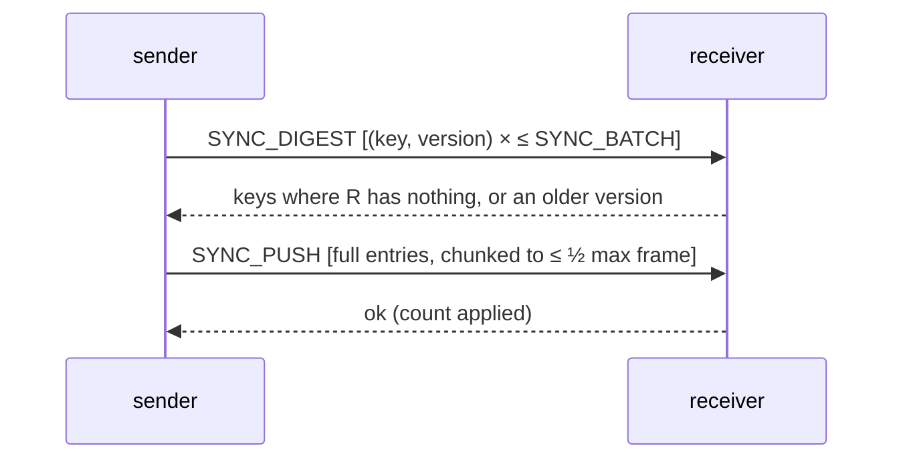

# Rebalancing, recovery and data movement

## One mechanism for every case

All data movement uses a single, idempotent, three-step exchange between a sender S and
a receiver R:

- R applies pushed entries only if they are **strictly newer** than its own copy, so
  stale data can never overwrite fresh data. This holds in both directions and for any
  interleaving with client writes.
- Repeating or interrupting the exchange is harmless, so no migration journal or resume
  protocol is needed: a crashed sync is simply run again.
- Every batch costs `len(batch)` tokens from a per-node **token bucket**
  (`SHC_SYNC_RATE_KEYS`, default 20,000 keys/s). Migration therefore cannot starve
  client traffic.
- Expired entries are never offered. Absolute expiry timestamps travel unchanged, so
  migration cannot extend a TTL.

Comparing every key's version is O(keys) per pass. A Merkle tree over ring ranges
would make the steady state O(differences); that is listed in the [roadmap](ROADMAP.md).

## Ownership rules

- **Ring members** are all members whose phase is not `left`: `joining`, `active` and
  `leaving` nodes, whether alive or dead.
- **Owners(key)** are the first N distinct ring members clockwise from `hash(key)`.
- **Routable owners** are owners that are `active` or `leaving`, not believed dead, and
  not covered by a dead mark. They serve reads and their acks count toward W.
- **Future owners** are owners computed on the ring *without* `leaving` members. They
  receive writes during a graceful leave.

Keeping joining nodes in the ring while making them non-routable is the key choice.
With consistent hashing, a new member enters a key's preference list and pushes at most
one old owner out of it. The remaining old owners keep their data and keep serving (they
are the routable owners) while the newcomer catches up. When the newcomer becomes
routable it already has the data, and only one ownership change happens, not two.

## Cases

### A node joins

1. A new process starts in phase `joining` with a new generation and contacts its seeds.
   Gossip adds it to every ring.
2. Coordinators now see it among the owners of some keys. They **send it every new write**
   but do not count its ack or route reads to it.
3. It sends `SYNC_REQUEST{target=self}` to every reachable peer. Each peer pushes every
   local key the target owns, using the exchange above.
4. When all reachable sources have answered (or became dead), it switches to `active`,
   bumps its incarnation and gossips immediately. Peers start routing to it.
5. The ring change triggers a **rebalance pass** on every node. Each node offers every
   local key to every reachable owner, then **drops** keys it no longer owns once all of
   that key's owners have confirmed holding a version at least as new.
   `RemoveIfVersion` makes the drop a compare-and-delete, so a concurrent newer write is
   never lost.

**When may the new owner serve?** Only after step 4. Before then it is not routable.
Writes are never lost during the transition: from step 2 onward, every write reaches it
directly, and every write before step 2 is covered by the sync in step 3.
`TestJoinRebalancesWithoutLosingConcurrentWrites` writes continuously during a join and
checks that every acknowledged value survives.

**Measured** (3 nodes → 4, 50k keys, N=3): node4 ready after 4.7 s, and after rebalancing
exactly 150,000 copies remain (50k × 3), so no duplicates are left behind
([BENCHMARKS](BENCHMARKS.md)).

### A node leaves gracefully (`POST /admin/leave`, or SIGTERM with `SHC_LEAVE_ON_SHUTDOWN=true`)

1. It switches to `leaving` and gossips. It is still routable, but every coordinator now
   also writes to the **future owners**.
2. It pushes every key to its future owners, retrying up to 3 passes.
3. It switches to `left` (terminal for its generation), gossips, and shuts down. The ring
   shrinks, and the future owners already hold the data.

`TestGracefulLeaveHandsOffData` checks every key survives.

### A node crashes

Ownership does **not** change at first: a dead member stays in the ring, and its keys
are served by the remaining owners. This avoids moving data because of a transient
failure. If it stays dead for `SHC_REMOVE_DEAD_AFTER`, a node that sees a strict majority
marks it `left`. The ring changes, and rebalancing copies each affected key from its
surviving owners to the new owners.

### A failed node returns

- **After a restart:** it is a new generation in `joining`, as described in the join case.
- **After a pause or partition:** it is the same generation, but covered by dead marks.
  It re-enters `joining` and syncs before it is routed to. See [FAILURE_MODES](FAILURE_MODES.md).
- **After it was removed:** it sees its own record as `left` and rejoins as a new
  generation.

Its stale local copies are harmless: they lose every version comparison against newer
data, and keys it no longer owns are dropped after handoff.

### A replacement node is introduced

Start the replacement with a **new ID** and the same seeds; it joins as above. Remove the
dead member with `POST /admin/remove?id=<old>`, or wait for automatic removal. Reusing
the old ID also works, because the newer generation supersedes the old record, and keeps
the old ranges, so less data moves.

## Throttling and progress

| Signal | Where |
|---|---|
| Recovery state (`running`/`complete`/`incomplete`), sources, keys received, errors | `GET /admin/status` → `recovery` |
| Last rebalance: keys offered, pushed and dropped; errors; duration | `GET /admin/status` → `rebalance` |
| `shc_sync_keys_pushed_total`, `shc_sync_keys_received_total`, `shc_sync_errors_total` | `/metrics` |
| `shc_rebalance_runs_total`, `shc_rebalance_dropped_keys_total`, `shc_recoveries_total{result}` | `/metrics` |

Each node runs at most one rebalance pass at a time, plus at most two concurrent join
syncs for other nodes. Several membership changes within two heartbeats are coalesced
into one pass.

## What is not claimed

Migration is **not** advertised as "zero-downtime" in general. Availability during a join
was tested only for the scenario in the tests: one node joining a healthy cluster under
continuous writes, with no lost acknowledged writes. Combinations such as a join
*during* a partition, or several simultaneous joins and removals, have not been tested.
